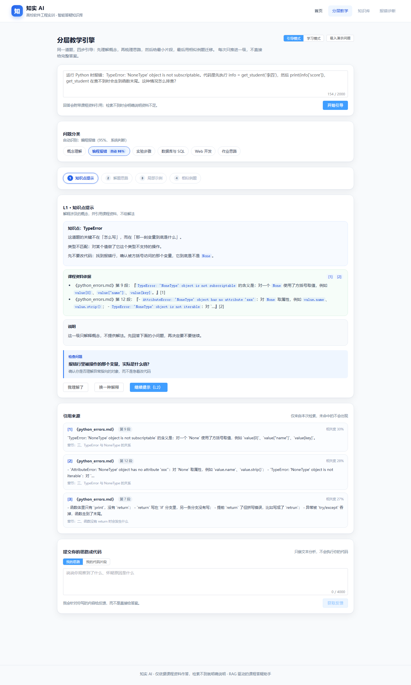
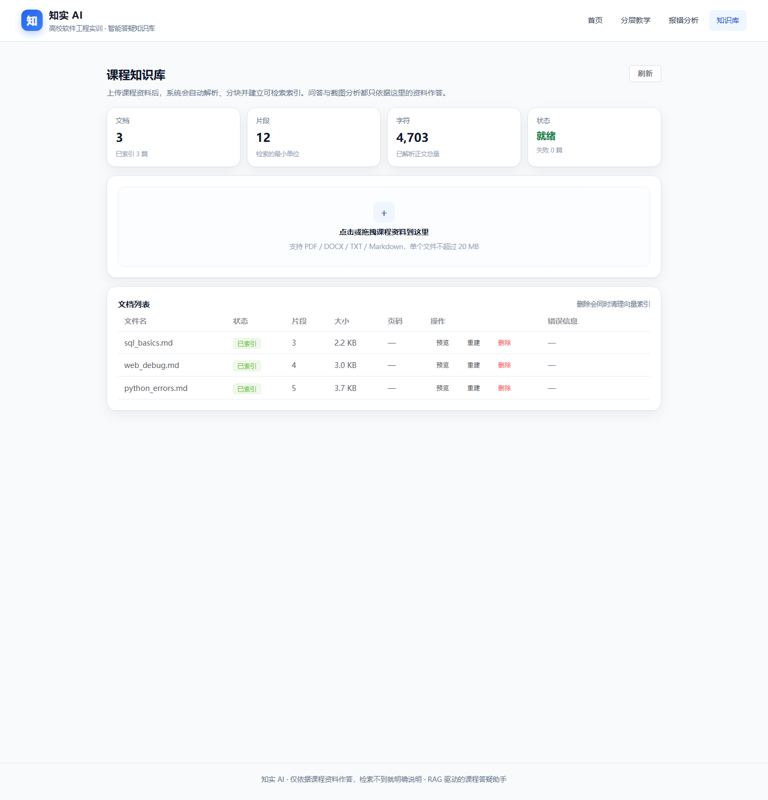
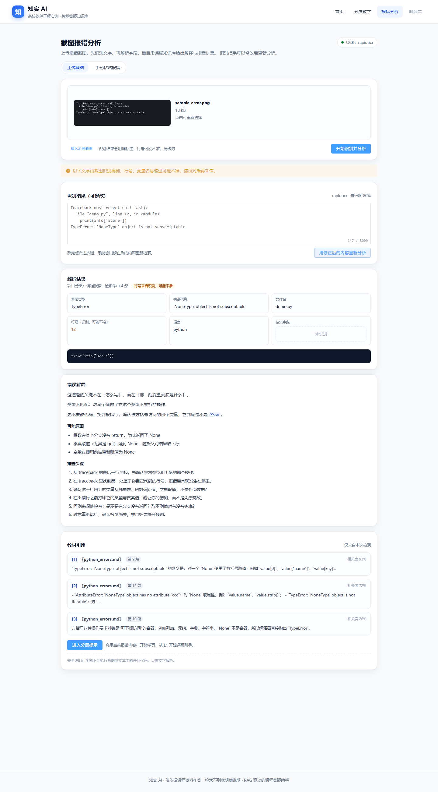

# 知实 AI（EduRAG）

> 高校软件工程实训智能答疑知识库 —— 只依据课程资料作答，并给出可核对的引用；资料里没有的，它会直接说没有。



---

## 它解决什么问题

学生在 Python、Web、数据库、软件工程实训里卡住时，通常直接把代码丢给通用 AI，然后复制答案。结果是：作业做完了，知识没学会，而且 AI 还经常编。

知实 AI 的四条底线：

1. **有据可查**：每条结论都附文档名与位置（页码 / 段落），可点开核对原文。
2. **无据则明说**：检索不到就明确说"资料不足"，绝不编造引用。
3. **引导优先**：默认不输出可直接提交的完整实现，分层提示逐级解锁。
4. **演示模式诚实**：未配置大模型时，检索真实执行、回答由模板生成，界面明确标注。

---

## 当前进度

| 模块 | 状态 | 说明 |
|---|---|---|
| 前后端骨架、配置、CORS | ✅ 已完成 | FastAPI + Vue 3，`/api/health` 健康检查 |
| **课程知识库** | ✅ 已完成 | PDF/DOCX/TXT/MD 上传、解析、分块、Chroma 持久化索引、删除同步清向量 |
| **分层教学引擎** | ✅ 已完成 | 六类问题分类、四级提示、安全护栏、提交反馈 |
| 教学页面 | ✅ 已完成 | 分类可手动调整、层级阶梯、引用卡片、四种状态 |
| **截图报错分析** | ✅ 已完成 | 本地 OCR / 视觉模型双通道、识别可编辑、复用检索与教学引擎 |
| RAG 问答聊天页 | 🚧 待开发（P2） | 当前问答能力通过教学页与报错分析页提供 |

> 检索现状：`backend/app/retrieval/service.py` 是**混合检索**——优先查知识库（Chroma 哈希向量 + 字面覆盖率的加权分数），不足时回落到内置示例资料的词面检索。
> 两套检索返回同一数据结构，教学引擎与报错分析无需感知差异。

---

## 课程知识库



- **支持 PDF / DOCX / TXT / Markdown**，单文件上限 20 MB（可配）
- **按内容 sha256 去重**：同一份文件重复上传不会产生重复索引
- **解析失败如实上报**：扫描版 PDF、空文件、编码异常都会在列表里显示具体原因
- **删除同步清理向量**：删文档会同时删 Chroma 里的块，不会"删了还能检索到"
- **可重建索引**：改了 `.env` 或怀疑索引损坏时点「重建」
- **分块预览**：能看到实际切出来的片段与页码，便于核对解析质量
- 首页与 `/api/health` 的知识库状态（文档数 / 片段数）来自真实登记表

索引结构：Chroma 持久化目录 `storage/chroma`，集合 `library_chunks_v1`，离线哈希向量（512 维）+ 字面覆盖率加权排序，不需要 GPU 与外网。

---

## 分层教学引擎

这是本项目的核心差异化功能，独立于检索与 HTTP 层，位于 `backend/app/teaching/`。

| 层级 | 给什么 | 明确不给什么 |
|---|---|---|
| **L1 知识点提示** | 异常类型含义、概念定位、课程资料原文引用 | 代码、步骤、解法 |
| **L2 解题思路** | 4–6 步检查顺序 | 代码、具体改法 |
| **L3 局部示例** | ≤6 行诊断片段 + 关键语句解释 | 完整函数、整份作业 |
| **L4 相似例题** | 同知识点、不同条件的例题（标注 AI 生成） | 原题答案 |

- **不能跳级**：服务端按 `current_level + 1` 强制压回，客户端传 4 也只能拿到 2。
- **不会泄露**：代码块超过 6 行截断、检测到完整函数体替换为骨架、命中"完整代码/直接复制"话术自动收敛。
- **不执行代码**：提交的代码只做文本分析，全模块无 `exec` / `eval` / `subprocess`。
- **资料只沾边时也答**：检索片段没真正覆盖这条报错时，会补一段明确标注「通用 Python 知识（非课程资料）」的诊断，不伪造引用、也不简单拒答。

详细设计见 [docs/04-分层教学引擎.md](docs/04-分层教学引擎.md)。

---

## 截图报错分析



上传报错截图 → 服务端校验格式与大小 → OCR 识别 → 解析异常类型/文件/行号/代码片段 → 复用同一套检索与教学引擎给出解释、可能原因、排查步骤和教材引用。

- **识别结果可编辑**：改完点「用修正后的内容重新分析」，用修正后的文本重新检索。
- **不把猜测当事实**：截图来源的行号一律标记 `line_estimated`，界面显示"识别，可能不准"。
- **双通道**：配置了 `VLM_*` 走视觉模型；否则用本地 rapidocr；都没有则返回 503 并引导到手动粘贴。
- **两条入口**：上传图片 或 直接粘贴报错文本，下游分析完全一致。
- **不执行代码**：只做文字解析，`safety.code_execution = disabled`。

详细设计见 [docs/05-截图报错分析.md](docs/05-截图报错分析.md)。

---

## 技术栈

| 层 | 选型 |
|---|---|
| 前端 | Vue 3 + Vite 6 + TypeScript + Element Plus + Pinia + markdown-it + DOMPurify |
| 后端 | Python 3.13 + FastAPI + Pydantic v2 + SQLAlchemy |
| 知识库 | ChromaDB（P1 接入）+ 文档解析 + 文本分块 + Embedding |
| 截图识别 | 本地 rapidocr-onnxruntime / OpenAI 兼容视觉模型 + Pillow 校验 |
| 测试 | pytest（后端）、`vue-tsc` + `vite build`（前端） |

---

## 快速开始

### 环境要求

- Python 3.13+
- Node.js 20+
- Git

### 1. 克隆与后端

```bash
git clone <repo-url>
cd <repo>
python -m venv .venv

# Windows
.\.venv\Scripts\python.exe -m pip install -r backend\requirements.txt
# macOS / Linux
.venv/bin/python -m pip install -r backend/requirements.txt
```

启动后端：

```bash
cd backend
..\.venv\Scripts\python.exe -m uvicorn app.main:app --reload --port 8000
```

- 健康检查：<http://127.0.0.1:8000/api/health>
- 接口文档：<http://127.0.0.1:8000/api/docs>

### 2. 前端

```bash
cd frontend
npm install
npm run dev
```

打开 <http://localhost:5173>。前端通过 Vite 代理访问 `/api`，无需额外配置跨域。

### 3. 导入演示资料（必须做一次）

```powershell
.\.venv\Scripts\python.exe scripts\seed_demo.py
```

会把 `backend/data/samples` 下的 4 份课程资料走**真实上传链路**导入知识库（解析 → 分块 → 建索引）。

### 4. 一键启动（Windows）

```powershell
.\scripts\dev.ps1
```

### 5. 自检演示用例

```powershell
# 5 个标准问题，输出 PASS / FAIL，全部通过才算演示环境就绪
.\.venv\Scripts\python.exe scripts\check_demo.py
```

### 6. 看分层教学效果

```powershell
# 命令行演示：同一道 Python 报错 L1 → L4
.\.venv\Scripts\python.exe scripts\demo_teaching.py
```

或在浏览器打开 <http://localhost:5173/teaching?demo=1>（自动载入演示问题并给出 L1）。

### 7. 看截图报错分析

```powershell
# 命令行演示：真实本地 OCR + 解析 + 检索
.\.venv\Scripts\python.exe scripts\demo_errors.py
```

或在浏览器打开 <http://localhost:5173/errors?demo=1>（自动载入示例截图并完成一次分析）。

---

## 配置

复制 `.env.example` 为 `.env`（**不要提交**）：

```bash
cp .env.example .env
```

| 变量 | 说明 |
|---|---|
| `LLM_API_KEY` | 留空 → 自动进入**演示模式**：检索真实执行，回答由模板生成，界面明确标注 |
| `DEMO_MODE` | `auto`（默认）/ `on` / `off`；现场模型 API 故障时设为 `on` 强制演示模式 |
| `EMBED_PROVIDER` | 留空时：配了 `EMBED_API_KEY` 走远程向量模型，否则用本地 `hash` 向量 |
| `RETRIEVAL_MIN_SCORE` | 检索阈值，低于该值视为"资料不足" |
| `OCR_PROVIDER` | `auto`（默认）/ `vision` / `rapidocr` / `none`；决定截图识别走哪条通道 |
| `VLM_BASE_URL` / `VLM_API_KEY` / `VLM_MODEL` | 视觉模型配置；三项齐全才启用远程 OCR，未配置时自动回落到本地 rapidocr |

所有密钥只放后端环境变量，前端拿不到；`/api/health` 只返回布尔值，不回显密钥。

---

## 目录结构

```
backend/
  app/
    api/            HTTP 路由（health / teaching / errors / library）
    core/           配置、日志
    library/        知识库：解析、分块、Chroma 索引、文档登记
    teaching/       分层教学引擎（分类、四级提示、护栏）
    retrieval/      混合检索（知识库优先 + 示例资料兜底）
    errors/         截图报错分析（校验、OCR、解析、编排）
    models/         Pydantic 契约
  data/
    samples/        4 份示例课程资料
    demo_cases.json 5 个标准问题与预期结果
  tests/            pytest 用例（103 个）
frontend/
  src/
    api/            接口客户端与类型
    views/          首页、分层教学、报错分析、课程知识库
    components/     分类选择、层级阶梯等
docs/               设计说明、截图与环境备忘
scripts/            dev / seed / check / demo 脚本
```

---

## 测试

```bash
cd backend
..\.venv\Scripts\python.exe -m pytest -q
```

当前 **103 个用例**，覆盖：知识库上传/去重/删除/重建/失败状态、混合检索、六类分类、四级提示的格式约束（L1/L2 无代码、L3 ≤6 行、L4 必带 AI 标记）、跳级拦截、引导模式需提交尝试、资料不足、输入清洗、泄露收敛、接口协议，以及截图分析的图片校验、OCR 后处理与各类失败状态。

演示用例（5 个标准问题，带预期结果）：

```powershell
.\.venv\Scripts\python.exe scripts\check_demo.py
```

前端：

```bash
cd frontend
npm run build     # 内含 vue-tsc 类型检查
```

---

## 部署

### 本地演示（推荐）

```powershell
.\scripts\dev.ps1
```

后端 8000（uvicorn）+ 前端 5173（Vite），SQLite/Chroma 数据都在 `storage/`，无需数据库服务。

### 单机长期运行

```powershell
# 后端
cd backend
..\.venv\Scripts\python.exe -m uvicorn app.main:app --host 127.0.0.1 --port 8000
# 前端静态构建
cd ..\frontend
npm run build
```

`dist/` 用 Nginx 指向，并把 `/api` 反向代理到 `127.0.0.1:8000`（避免跨域问题）。示例 Nginx 片段：

```nginx
server {
    listen 80;
    root /path/to/frontend/dist;
    location / { try_files $uri $uri/ /index.html; }
    location /api/ { proxy_pass http://127.0.0.1:8000; }
}
```

### 注意事项

- 只支持单 worker：Chroma 是本地文件库，多进程会有锁竞争
- `storage/` 需持久化（文档、索引、登记表都在里面）
- 未配置模型 API 时自动进入演示模式，功能仍完整可用

## 已知限制

1. 未配置模型时提示由模板生成，措辞固定；配置后 L1–L3 由模型润色，模型失败会自动回退模板并在页面标注。L4 始终使用固定题库并标注 AI 生成。
2. L4 例题来自固定题库（每类 2 道），"换一种解释"会循环。
3. 提交反馈基于关键词判定，只能给方向性提示，不判断代码是否正确（这是"不执行用户代码"的代价）。
4. 检索用离线哈希向量（词面相似度，不是语义模型），同义改写仍可能漏检；接入 Embedding API 后可按同一接口替换。
5. 扫描版 PDF 没有文本层，会在列表里标记失败并说明原因，需要先 OCR。

---

## 路线图

- **P1** ✅ 文档入库：PDF / DOCX / TXT / Markdown → 解析 → 分块 → Chroma 索引
- **P2** ✅ 大模型接入：L1–L3 由模型生成、失败自动回退模板；流式输出与独立聊天页待做
- **P3** 独立聊天界面（当前问答通过教学页与报错分析页提供）
- **P4** 报错诊断增强（多帧定位、批量截图）
- **P5** 评测集与指标看板

详细计划见 [PLAN.md](PLAN.md)。

---

## 文档

| 文档 | 内容 |
|---|---|
| [DEMO_SCRIPT.md](DEMO_SCRIPT.md) | 2 分钟现场演示脚本、讲解词、翻车预案 |
| [TROUBLESHOOTING.md](TROUBLESHOOTING.md) | 常见错误、原因与处理 |
| [PLAN.md](PLAN.md) | 完整开发计划、架构与风险 |
| [docs/04-分层教学引擎.md](docs/04-分层教学引擎.md) | 教学引擎设计、约束与测试 |
| [docs/05-截图报错分析.md](docs/05-截图报错分析.md) | OCR 通道、图片校验、字段解析与复用链路 |
| [docs/03-本地开发环境备忘.md](docs/03-本地开发环境备忘.md) | 环境配置与常见错误对照 |
| [docs/00-环境勘察报告.md](docs/00-环境勘察报告.md) | 本机环境勘察与 Git 安装记录 |


