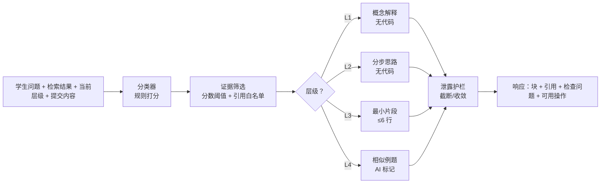

# 分层教学引擎设计说明

> 目标：让学生通过逐步提示自己解决问题，而不是复制 AI 生成的答案。
> 代码位置：`backend/app/teaching/`（独立于检索、独立于 HTTP），API 在 `backend/app/api/teaching.py`。

---

## 1. 设计原则

| 原则 | 落地方式 |
|---|---|
| 教学逻辑与协议解耦 | 引擎只吃 `TeachingRequest`，不依赖 FastAPI、不依赖数据库 |
| 检索结果作为显式入参 | 请求里带 `retrieval`，引擎不自己检索；P1 换 Chroma 时引擎零改动 |
| 每次只能升一级 | 服务端按 `current_level + 1` 压回，客户端传 4 也只能拿到 2 |
| 无据不说有据 | 证据低于阈值时不进生成分支，直接给出"资料不足"提示块 |
| 不执行不可信代码 | 全模块只有字符串处理，没有 `exec` / `eval` / `subprocess` |
| AI 生成内容必须标记 | Level 4 的例题强制带「AI 生成示例 · 非教材原文」 |



---

## 2. 六类问题分类

规则打分 + 检索文本弱加权（`0.4` 倍，只用于破平手），可被用户覆盖。

| 分类 | 典型信号 |
|---|---|
| 概念理解 | "是什么 / 原理 / 区别 / 为什么" |
| 编程报错 | `Traceback`、`XxxError`、行号、"报错" |
| 实验步骤 | "实验 / 实训 / 环境配置 / 提交" |
| 数据库与 SQL | `SELECT/JOIN`、`NULL`、表/索引/事务 |
| Web 开发 | `Vue/axios/CORS`、Console/Network、跨域 |
| 作业思路 | "帮我写 / 完整代码 / 题目要求" |

平手时优先级：**报错 > SQL > Web > 实验 > 作业 > 概念**（"实验里的 SQL 报错"应该按报错处理）。
无任何信号时给概念分类并标注低置信度（0.2），不假装很确定。

**用户可改**：请求带 `category` 时 `category_source="user"`，置信度 1.0，并在前端高亮。

---

## 3. 四级提示

| 级别 | 给什么 | 明确不给什么 |
|---|---|---|
| **L1 知识点** | 异常类型含义、概念定位、课程资料原文引用 | 代码、步骤、解法 |
| **L2 思路** | 4–6 步检查顺序，先查什么后查什么 | 代码、具体改法 |
| **L3 局部示例** | ≤6 行诊断片段 + 关键语句解释 | 完整函数、整份作业 |
| **L4 相似例题** | 同知识点、不同条件的例题 + 追问 | 原题答案；例题也标 AI 生成 |

每一级都带一个**检查问题**（推动学生解释自己的理解）与**可用操作**（我理解了 / 继续提示 / 换一种解释 / 提交）。

`换一种解释` 不升层，只换措辞（L1 换叙述角度，L2 调整步骤顺序，L3 换解释顺序，L4 换一道例题）。

---

## 4. 引用与证据

- 只允许引用本次 `retrieval` 中的块，按分数倒序取前 3，低于阈值的丢弃。
- 位置标注如实：有页码写"第 N 页"，只有段落写"第 N 段"，都没有写"未标注位置"。
- 引用编号在响应里连续（1..n），每个提示块记录自己用了哪几条。
- 检索不足时：不给引用，输出"资料范围提示 / 检索不足"块，并说明解释属于通用知识。

当前阈值（可在请求里覆盖）：

| 场景 | 阈值 |
|---|---|
| 教学引擎默认 | `min_evidence_score = 0.15` |
| 临时关键词检索 | 分数经过 IDF 加权与命中词数加成，实测示例问题 0.27–0.46 |

---

## 5. 安全护栏

| 风险 | 措施 |
|---|---|
| 代码执行 | 模块无 `exec/eval/subprocess`，有测试断言源码不含这些调用 |
| 一层给太多 | 代码块有效行 > 6 时截断并注明；`def` 带 4 行以上函数体直接替换为骨架 |
| 话术泄露 | 命中"完整代码/直接复制/答案如下"等短语时替换为收敛提示 |
| 输入攻击 | 去控制字符、压缩空行、长度上限（问题 2000 / 提交 4000） |
| 违规升层 | 服务端 clamp，返回 `clamped=true` 并在前端提示 |

---

## 6. 检索的现状与替换点

当前 `backend/app/retrieval/keyword.py` 是**临时实现**：

- 段落级关键词检索，IDF 加权 + 停用词过滤 + 命中数加成；
- 按问题分类路由到对应课程文档（`error → python_errors.md` 等），这是 P1 用 Chroma 做元数据过滤的雏形；
- **能力边界**：字面匹配，没有语义理解；同义改写、长句概括会漏检。

P1 替换为 Chroma 向量检索时，只需保持 `search(query, top_k, category) -> list[RetrievedChunk]` 这个签名，教学引擎与 API 都不用改。

---

## 7. 测试覆盖（58 个用例）

| 文件 | 覆盖点 |
|---|---|
| `test_classifier.py` | 六类分类、用户覆盖、低置信兜底、检索不干扰主信号 |
| `test_teaching_levels.py` | L1 无代码 / L2 仅步骤 / L3 片段 ≤6 行且非完整实现 / L4 必须带 AI 标记、跳级被压回、资料不足、换一种解释、双模式差异、分类覆盖 |
| `test_guards.py` | 输入清洗、行数统计、截断、完整实现检测、话术收敛、源码无执行调用 |
| `test_teaching_api.py` | 分类/层级/提示/反馈接口、跳级、缺参数 400、422 校验、演示接口返回真实检索 |
| `test_retrieval_keyword.py` | 分词、路由、库外问题零命中、排序 |

---

## 8. 已知限制

1. **模板生成**：当前四级提示由模板 + 检索片段拼装，稳定但不够灵活；接入大模型后应保留同一套护栏与结构。
2. **L4 例题是固定题库存放**（每个分类 2 道），`variant` 递增会循环；大模型接入后可实时生成，但仍需强制标记。
3. **提交反馈是关键词判定**，只能给方向性反馈，不能判断代码是否真的正确。
4. **分类器是规则**，遇到"帮我看看这段代码哪里错了"这类无强信号的问题，可能落到概念分类，需要用户手动调整。

---

## 9. 演示

```powershell
# 命令行演示：同一道 Python 报错 L1 → L4
.\.venv\Scripts\python.exe scripts\demo_teaching.py

# 浏览器演示
# 1) 启动前后端（scripts\dev.ps1）
# 2) 打开 http://localhost:5173/teaching
# 3) 点「载入演示问题」→「开始引导」
```

演示题目固定为：

> 运行 Python 时报错：TypeError: 'NoneType' object is not subscriptable。
> 代码里先执行 `info = get_student('李四')`，然后 `print(info['score'])`，
> `get_student` 在查不到时会走到函数末尾。这种情况怎么排查？
