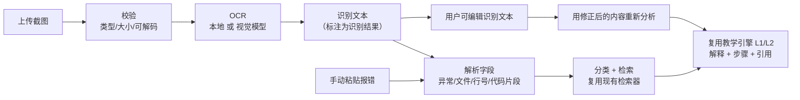

# 截图报错分析设计说明

> 目标：学生把报错截图丢进来，系统识别文字 → 解析字段 → 用课程知识库给出解释、原因、排查步骤和引用。
> 代码位置：`backend/app/errors/`，页面 `/errors`。

---

## 1. 用户流程



关键点：**图片只是入口，最终走的还是同一条检索与教学链路**，没有第二套问答系统。

---

## 2. OCR 通道

| 通道 | 触发条件 | 特点 |
|---|---|---|
| `vision` | 配置了 `VLM_BASE_URL` / `VLM_API_KEY` / `VLM_MODEL`，且 `OCR_PROVIDER=auto` 或 `vision` | 识别质量通常更好，但依赖外部服务；输出标注"模型可能补全" |
| `rapidocr` | 未配置视觉模型，且本地依赖可用 | 离线可用；首次识别需加载模型（约 1–2 秒），单张约 3–5 秒 |
| `none` | `OCR_PROVIDER=none` 或两条通道都不可用 | 接口返回 503，前端引导到「手动粘贴报错」 |

本地 OCR 的产物会经过三步后处理：

1. **按纵坐标聚行**：OCR 只给单词级框，需要重组成文本行；
2. **按横坐标拼词**：英文之间补空格、标点前后不补，`in <module>` 这类保持可读；
3. **按左侧留白还原缩进**：代码截图没有缩进基本没法读。

---

## 3. 图片校验

| 检查 | 规则 | 失败响应 |
|---|---|---|
| 大小 | 默认 ≤ 8 MB（`OCR_MAX_IMAGE_MB`） | 413 |
| 真实格式 | 按文件头判断 PNG / JPEG / WEBP，扩展名不作数 | 415 |
| 声明类型 | `Content-Type` 必须是图片 | 415 |
| 可解码 | Pillow 完整解码，能发现截断文件 | 422 |
| 尺寸 | 短边 < 40px 视为无效 | 422 |
| 预处理 | 长边 > `OCR_MAX_SIDE` 等比缩小，统一转 PNG | — |

---

## 4. 解析字段与"不确定"标注

| 字段 | 来源 | 不确定性处理 |
|---|---|---|
| `exception_type` | 兜底向上找 `XxxError` / `XxxException` | 找不到就留空并计入 `missing` |
| `message` | 异常行冒号后的内容 | 同上 |
| `file` / `line` | traceback 里的 `File "...", line N` | **截图来源一律 `line_estimated=true`**，前端显示"识别，可能不准" |
| `code_snippet` | 帧的下一行 | 可能被 OCR 断行，前端可编辑 |
| `frames` | 所有帧 | 保留顺序，便于将来做多帧定位 |
| `language` | traceback / JS 帧 / SQL 关键字 | 无法判断时为 `unknown` |

**硬性规则**：行号永远不作为确定事实输出，接口里用 `line_estimated` 显式表达，前端用醒目颜色标注，并在回答的 `safety.line_numbers` 里写 `recognized/uncertain`。

---

## 5. 复用检索与教学引擎

```python
parsed = parse_error(text, line_estimated=(source == "image"))
category = classify(text)
query = exception_type + message + code_snippet
chunks = get_retriever().search(query, top_k=4, category=category)
level1 = engine.respond(TeachingRequest(current_level=0, target_level=1, retrieval=chunks, ...))
level2 = engine.respond(TeachingRequest(current_level=1, target_level=2, retrieval=chunks, ...))
```

- 解释取自教学引擎 L1 的 `explain` 块；
- 排查步骤取自 L2 的 `steps` 块；
- 引用直接复用 L1 的 `citations`（同一套白名单与阈值）；
- 检索不足时，`warnings` 会追加"知识库中没有检索到直接相关的课程资料"。

因此**截图功能不会影响原有 RAG 问答**：它只是"把一段文本塞进既有链路"。

---

## 6. 接口

| 方法 | 路径 | 说明 |
|---|---|---|
| GET | `/api/errors/capabilities` | 当前 OCR 通道、可用性、大小与格式限制 |
| GET | `/api/errors/sample-image` | 演示用报错截图（服务端绘制） |
| POST | `/api/errors/analyze-image` | multipart 上传，走 OCR + 分析 |
| POST | `/api/errors/analyze-text` | JSON `{text, edited}`，手动粘贴或修正后重新分析 |

响应核心结构：

```json
{
  "source": "image",
  "recognized_text": "...",
  "ocr": {"provider": "rapidocr", "mean_confidence": 0.80, "low_confidence": false, "warnings": []},
  "parsed": {"exception_type": "TypeError", "line": 12, "line_estimated": true, "missing": []},
  "causes": ["..."], "steps": ["..."],
  "citations": [{"index": 1, "doc_name": "python_errors.md", "location": "第 9 段", "score": 0.93}],
  "retrieval": {"hit_count": 4, "sufficient": true},
  "teaching_entry": {"question": "...", "path": "/teaching?question=..."},
  "warnings": ["以下文字由截图识别得到，行号、变量名与缩进可能不准，请核对后再采信。"],
  "safety": {"code_execution": "disabled", "line_numbers": "recognized/uncertain"}
}
```

---

## 7. 前端交互

- **两种入口**：上传截图 / 手动粘贴报错，顶部可切换；
- **上传**：点击或拖拽、图片预览、文件名与大小；提交前先做一次客户端校验（类型、大小）给即时反馈，服务端仍然权威；
- **识别结果可编辑**：`textarea` 预填识别文本，改完点「用修正后的内容重新分析」→ 走 `/analyze-text`；
- **解析结果**：异常类型、错误信息、文件名、行号（识别，可能不准）、语言、缺失字段；缺失时显示"未识别"；
- **结果区**：错误解释、可能原因、排查步骤、教材引用（带相关度）、「进入分层提示」按钮（带着当前报错跳到教学页 L1）；
- **状态**：加载中、接口错误、OCR 不可用、无引用都有对应提示。

---

## 8. 测试

| 文件 | 覆盖 |
|---|---|
| `test_errors_parser.py` | Python traceback、单行异常、JS、SQL、缺失字段、行号标记 |
| `test_errors_ocr.py` | 全角标点归一、拼词、聚行、缩进还原、空输入 |
| `test_errors_api.py` | 能力接口、文本分析、编辑后重分析、图片分析（假 OCR）、格式错误 415、过大 413、损坏 422、OCR 不可用 503、识别失败 422 |

图片相关用例使用假 OCR 实现，**不加载真实模型**，保证测试快且稳定；真实 OCR 由 `scripts/demo_errors.py` 手动验证。

---

## 9. 已知限制

1. **本地 OCR 会漏字符**：示例截图里 `Traceback (` 的左括号就丢了（缩进与其余内容正确）。所以产品上强制"可编辑 + 标注"。
2. **行号可能错**：OCR 对数字的识别并非零错误，`line_estimated` 必须保留。
3. **视觉模型通道未实测**：本机没有配置 `VLM_*`，代码路径已实现但未跑过真实调用。
4. **只支持单页截图**：长截图（多屏滚动）会按一张图识别，可能串行错乱。
5. **不执行代码**：这是设计约束，因此"你的代码到底对不对"无法验证，只能给排查方向。
