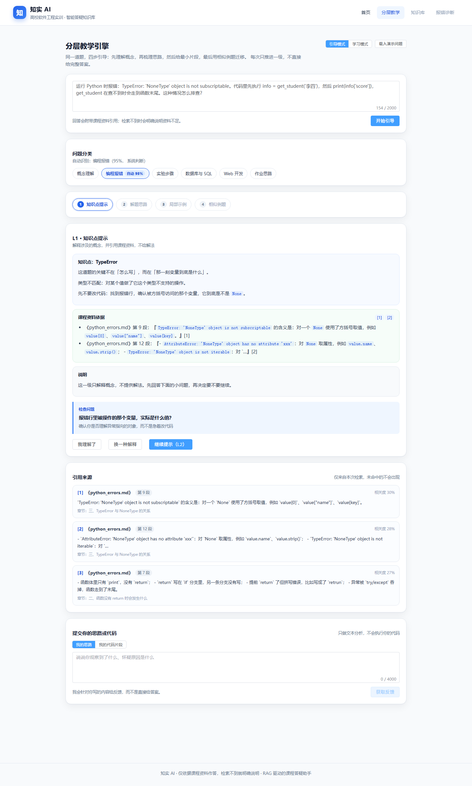
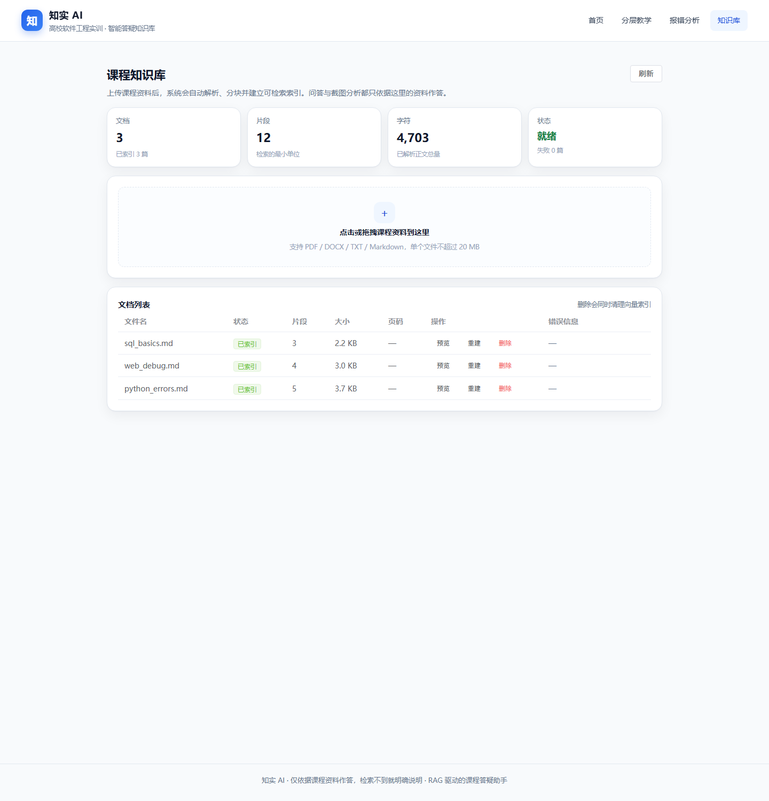
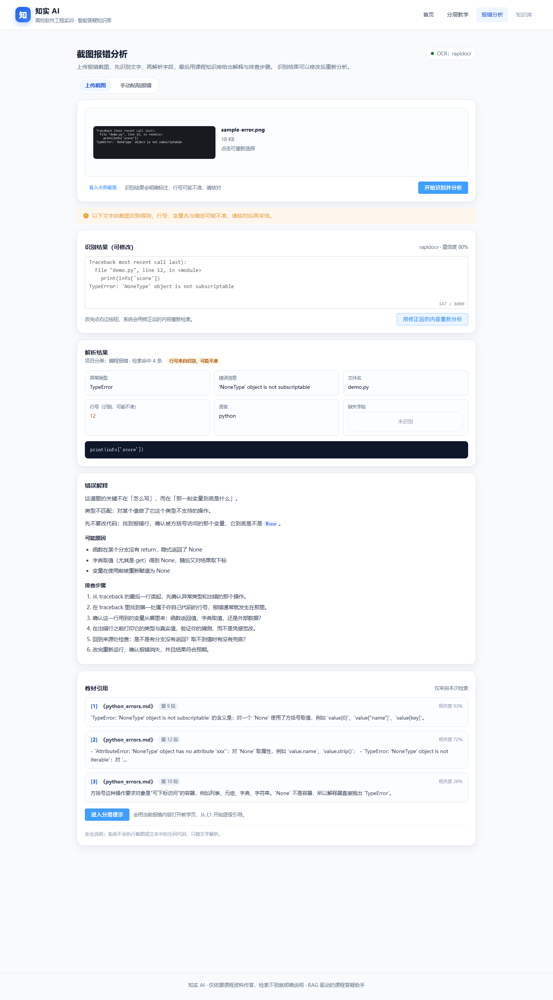

# 知实 AI（EduRAG）技术文档

> 2026 第九届传智杯 · AI WEB 网页开发挑战赛（团队赛）
> 参赛编号 2107793 ｜ 广东工商职业技术大学 · 计算机学院
> 队员：卢文浩（2024120322103）、时森林（2024120322101）、张峻炜（2024120322102）
> 指导老师：梁少萍 ｜ 联系方式：<2833029991@qq.com>

---

## 1 项目概述

### 1.1 背景与问题

学生在 Python、Web、数据库与软件工程实训中卡住时，最常见的做法是把代码或报错截图直接丢给通用 AI，然后复制答案。结果是作业完成了、知识没学会，而通用 AI 还会编造并不存在的 API、参数与错误原因。对教学场景而言，"给答案"不是帮助，反而替代了学生最需要经历的诊断过程。

与此同时，课程资料（实训讲义、实验指导书、常见错误整理）本身是可核查的依据，但学生往往不会去翻，或者翻到了也不知道哪一段对应自己的问题。

### 1.2 产品定位

知实 AI 是一个**面向高校软件工程实训的 RAG 智能答疑知识库**：只依据已导入的课程资料作答，每条结论都附可点开的引用；资料里没有的，明确说"资料不足"，不编造、不猜测。

作品形态是 Web 应用：Vue 3 + Vite + TypeScript 前端，FastAPI 后端仅承担 AI 能力接入与业务编排。当前有四个页面：首页（系统状态）、分层教学、截图报错分析、知识库管理。

### 1.3 四条底线

1. **有据可查**：每条结论附文档名与位置（页码 / 段落），可点开核对原文。
2. **无据则明说**：检索不到或覆盖度不足就明确说"资料不足"；对常见 Python 报错，可给出标注为「通用 Python 知识（非课程资料）」的诊断，但绝不伪装成课程依据。
3. **引导优先**：默认不输出可直接提交的完整实现；提示按 L1→L4 逐级解锁，引导模式下进入 L3（局部示例）前必须先提交自己的尝试。
4. **演示模式诚实**：未配置大模型时，检索真实执行、回答由模板生成，界面与响应字段明确标注；配置模型后 L1–L3 由模型润色，失败自动回退模板并标注来源。



*图 1　分层教学页面：L1 知识点提示与可核对引用*

### 1.4 已完成能力

| 模块 | 状态 | 说明 |
|---|---|---|
| 前后端骨架、配置、CORS、健康检查 | 已完成 | FastAPI + Vue 3 |
| 课程知识库 | 已完成 | PDF/DOCX/TXT/MD 上传、解析、分块、Chroma 索引、删除同步清向量、分块预览 |
| 混合检索 | 已完成 | Chroma 向量 + 字面覆盖率加权，不足时回落内置示例词面检索 |
| 分层教学引擎 | 已完成 | 六类分类、四级提示、安全护栏、提交反馈、L3 提交门槛 |
| 通用知识层与证据覆盖度 | 已完成 | 资料只沾边不误判为有据；13 类常见报错给标注清楚的通用诊断 |
| 大模型接入 | 已完成 | OpenAI 兼容调用，L1–L3 润色，失败回退，`DEMO_MODE` 强制切换 |
| 截图报错分析 | 已完成 | 四通道 OCR、识别可编辑、复用检索与教学引擎 |
| RAG 独立聊天页 | 待开发 | 当前问答通过教学页与报错分析页提供 |

---

## 2 需求分析

### 2.1 用户角色

- **学生（主要用户）**：有课程资料、有具体问题，希望得到"够用但不越界"的提示；需要知道依据来自哪一段资料，也需要一个能逐级引导而不是直接给答案的助教。
- **教师 / 资料维护者**：上传、重建、删除课程资料；通过知识库状态确认索引是否正常。
- **评委 / 复现者**：clone 仓库后 10 分钟内跑起来，不配置任何密钥也能看到完整演示。

### 2.2 功能需求

| 编号 | 需求 | 说明 |
|---|---|---|
| F1 | 课程知识库 | 支持 PDF / DOCX / TXT / Markdown，单文件 ≤20 MB / ≤300 页；按 sha256 去重；解析失败如实上报 |
| F2 | 文档索引 | 分块 → 离线向量 → Chroma 持久化；删除同步清向量；可重建索引、预览分块 |
| F3 | 混合检索 | 知识库优先，分数不足时回落内置示例资料；统一返回结构 |
| F4 | 问题分类 | 六类：概念理解、编程报错、实验步骤、数据库与 SQL、Web 开发、作业思路；可人工覆盖 |
| F5 | 分层提示 | L1 知识点提示 / L2 解题思路 / L3 局部示例 / L4 相似例题；每次最多推进一级 |
| F6 | 引导门槛 | 引导模式下进入 L3 前必须提交自己的思路或代码片段 |
| F7 | 引用与核对 | 每条结论带文档名与位置；模型输出中的越界引用编号被剔除 |
| F8 | 无据处理 | 覆盖度不足时说明资料不足；常见报错可给标注清楚的通用诊断 |
| F9 | 截图报错分析 | 上传截图 → OCR → 文本清洗 → 可编辑 → 复用检索与教学引擎 |
| F10 | 状态可解释 | 页面展示模型生成 / 模板生成 / 回退状态、资料覆盖度徽章、当前层级进度 |
| F11 | 演示模式 | 无 Key 自动进入；`DEMO_MODE=on` 可强制开启，用于现场故障回退 |

### 2.3 非功能需求

- **离线可跑**：默认哈希向量 + 本地 OCR，无 GPU、无外网也能完整演示。
- **安全**：不执行用户代码（无 `exec` / `eval` / `subprocess` 调用）；前端 DOMPurify 清洗；密钥只在后端读取，`/api/health` 只回布尔值。
- **可复现**：仓库不含 `storage/`，提供 `seed_demo.py` 与一键脚本，5 步 ≤10 分钟。
- **可测试**：124 个后端用例；测试强制演示模式且不读本机 `.env`，绝不触发外部 API。
- **诚实标注**：模板回答、通用知识、失败回退都在界面与响应里标明来源。

### 2.4 需求边界

明确不做：代写作业、输出可直接提交的完整实现、登录与多租户、流式输出（当前结构化块返回）、独立聊天页、Agent 工具调用、语义 Embedding（当前离线哈希向量）。这些不是遗漏，而是为了保证"教学优先、零配置复现、链路可控"的取舍；详见第 7 章。

---

## 3 系统架构设计

### 3.1 总体架构

```
浏览器（Vue 3 + Vite + TypeScript）
    │  HTTP / JSON，Vite 代理 /api
    ▼
FastAPI 应用（app/main.py）
    ├── /api/health        健康检查与运行模式
    ├── /api/teaching/*    分类、四级提示、提交反馈、演示用例
    ├── /api/library/*     上传、列表、重建、分块预览
    └── /api/errors/*      OCR 能力、示例图、文本/图片分析
    ▼
领域模块
    core（配置）  library（入库索引）  retrieval（混合检索）
    knowledge（通用知识）  teaching（引擎/护栏）  errors（OCR/解析）
    llm（模型客户端与提示词）  models / api（协议）
    ▼
Chroma（storage/chroma，集合 library_chunks_v1） + 本地文件系统（storage/library）
```

### 3.2 后端模块职责

| 模块 | 职责 |
|---|---|
| `app/core/config.py` | pydantic-settings 统一配置；`llm_configured` / `demo_mode` / `embed_provider` 判定 |
| `app/library/` | 文档解析、分块、哈希向量、Chroma 索引、登记表、去重与删除 |
| `app/retrieval/` | `CompositeRetriever`：知识库检索优先，内置示例词面检索兜底 |
| `app/knowledge/general.py` | 13 类常见 Python 报错的通用诊断与覆盖标记 |
| `app/teaching/` | 分类、四级提示模板、证据构建、安全护栏、反馈、引擎编排 |
| `app/errors/` | 图片校验、四通道 OCR、字段解析、截图分析编排 |
| `app/llm/` | OpenAI 兼容客户端（重试、超时、回退）与提示词模板 |
| `app/api/` | HTTP 协议转换与请求补齐，不承载业务逻辑 |

### 3.3 检索链路

`CompositeRetriever.search()` 先调用 `LibraryIndex.search()`：把查询与分块都映射成 512 维哈希向量，计算余弦相似度，再叠加字面覆盖率，按 `0.75 × 余弦 + 0.25 × 字面` 得到最终分数。若返回数量不足 `top_k`，用 `KeywordRetriever` 从内置示例资料按 IDF 加权词面匹配补齐。两条路径返回同一个 `RetrievedChunk` 结构，上层引擎无需感知差异。

检索结果进入 `build_citations()`：低于 `min_evidence_score`（默认 0.15）的片段被剔除，留下的片段按文档名 + 位置生成可核对引用。

### 3.4 一次请求的完整数据流

```
问题 → 分类（六类，置信度）→ 按分类检索（top_k=4）
    → 构建引用（分数过滤）→ 证据覆盖度判定
    → 生成分层提示（L1–L4，受跳级与 L3 提交门槛约束）
    → 安全护栏（代码块 ≤6 行、完整实现检测、泄露短语收敛、引用编号清洗）
    → 若已配置模型且层级为 L1–L3：只把被引用片段交给模型润色，失败回退模板
    → 响应（blocks / citations / check_question / llm_status / safety / insufficient_evidence）
```

### 3.5 部署形态

本地开发为两个独立进程：后端 uvicorn `:8000`，前端 Vite `:5173`，Vite 把 `/api` 代理到后端，避免跨域配置。生产可 `npm run build` 后用静态服务器托管 `frontend/dist`，后端单独部署；仓库另提供 `scripts/dev.ps1` 一键起双服务。本次独立验证使用 `:8001` / `:5174` 端口，与另一工作副本隔离。

---

## 4 AI 技术方案

### 4.1 技术选型与理由

| 选型 | 理由 |
|---|---|
| **OpenAI 兼容协议** | 用 `LLM_BASE_URL` 可替换供应商，不被单一厂商锁定；客户端只需实现一次 |
| **pydantic-settings** | 环境变量 + `.env` 双通道，类型校验完善；满足"密钥不进仓库"的官方要求 |
| **Chroma** | 纯 Python、本地持久化、无需独立服务；适合单机演示与评测 |
| **离线哈希向量** | 字符 n-gram 哈希映射，不需要 GPU、不需要外网、不需要 Key；评委零配置也能跑完整检索 |
| **rapidocr-onnxruntime** | 本地 OCR，截图分析在离线环境也可用；视觉模型作为可选增强通道 |
| **不引入 LangChain** | RAG 链路短且需要精确控制（引用过滤、层级约束、护栏），自建链路代码更少、行为可预测、便于写测试 |

### 4.2 知识表示与混合检索

`backend/app/library/embeddings.py` 定义 `EMBED_VERSION = "hash-char-ngram-v1"`、`EMBED_DIM = 512`。`embed_text()` 把文本切成字符 n-gram，用 `zlib.crc32` 把每个特征映射到 512 个槽位并累加，得到稀疏但稳定的向量；同一段文本永远得到同一向量，无需模型下载。

分块参数：目标 500 字符、重叠 80 字符、单块上限 800 字符（`chunker.py`）。重叠从**句子边界**开始计算，避免引用卡片以半句话开头——这是人工核对引用时发现并修复的问题（提交 `dbdba11`）。

`index.py` 中 `VECTOR_WEIGHT = 0.75`、`LEXICAL_WEIGHT = 0.25`，最终分数为二者加权；既保留主题相似性，又不放过关键词精确匹配。集合名 `library_chunks_v1`，命名带版本号，便于将来索引结构升级时平滑迁移。

> **口径说明**：`/api/health` 回显 `embed_dim: 1024` 是 `config.py` 中为将来接远程语义 Embedding 预留的默认值；当前实现的真实维度是 `EMBED_DIM = 512`。配置是可调参数，实现是当前取值，二者不矛盾。

### 4.3 集成方式（大模型）

- **调用层**：`app/llm/client.py` 用 OpenAI 兼容的 Chat Completions 协议，带超时、重试与异常上抛；`stream: False`，因为当前回答是有结构的块（讲解 / 步骤 / 例题 / 检查问题），不适合逐 token 渲染。
- **生效范围**：只有 L1–L3 的讲解文本交给模型润色；L4 使用固定题库，始终不由模型改写，保证"相似例题"来自资料、可控可核。
- **只传被引用片段**：模型上下文里只放通过引用过滤的片段；输出中的引用编号经 `sanitize_citations()` 清洗，越界编号会被剔除并标记。这同时降低 token 消耗与"编造引用"风险（提交 `f844a91`，8 个相关测试）。
- **失败回退**：模型超时、报错或返回不可用时，自动回退模板，响应里 `llm_status` 从 `model` 变为 `fallback`；未配置模型时为 `template`。前端同步显示来源，不把模板伪装成 AI 生成。
- **强制演示模式**：`DEMO_MODE` 支持 `auto`（按是否配置模型自动判断）/ `on`（强制演示）/ `off`（强制非演示）。现场 API 故障时设 `on` 重启即可，检索与引用完全不受影响。
- **实测证据**：配置真实 Key 后，`/api/health` 返回 `demo_mode: false` / `llm_configured: true`；一次真实 L1 请求 HTTP 200、4.62 秒、`llm_status: "model"`（见 `docs/assets/health-check-evidence.md`）。

### 4.4 提示词约束

提示词模板（`app/llm/prompts.py`）明确要求：只依据给定资料作答、不得输出可直接提交的完整实现、按层级输出指定结构、引用只能使用资料中真实存在的编号、语气为引导而非代写。测试 `test_prompt_contains_sources_and_rules` 与 `test_prompt_does_not_leak_api_key` 分别锁定"规则存在"与"提示词不含密钥"。

### 4.5 证据覆盖度与通用知识层

课程资料永远覆盖不全。若只要关键词"沾边"就算有据，会出现"资料里提了一句、模型就编出一大段"的问题。系统因此做了两层判断：

1. **覆盖度判定**：对常见报错，检查资料中是否出现该模式的特征短语（如 `concatenate str`、`not subscriptable`、`division by zero` 等）。只有命中标记才算资料真的讲到这类问题；否则 `insufficient_evidence = true`。
2. **通用知识层**（`app/knowledge/general.py`）：覆盖 13 类常见 Python 报错（类型不匹配、字符串拼接、None 下标、不可调用、不可迭代、缺少属性、索引越界、int 字面量、缩进、参数个数、除零、模块缺失、名称未定义、KeyError 等），给出症状解释、可能原因与排查步骤，并在界面明确标注「通用 Python 知识（非课程资料）」。

这样既不误报"资料有据"，也不会面对常见错误只会说"我不知道"。相关行为由 6 个测试固定。

### 4.6 优化策略

| 优化 | 做法 | 收益 |
|---|---|---|
| 混合加权 | 0.75 向量 + 0.25 字面 | 兼顾主题相似与关键词精确匹配 |
| 句子边界分块重叠 | 重叠从完整句子起算 | 引用卡片不出现半句开头 |
| sha256 去重 | 同内容重复上传不重复索引 | 避免索引膨胀与重复引用 |
| 删除同步清向量 | 删文档同时删 Chroma 对应块 | 不会"删了还能检索到" |
| 只传被引用片段 | 模型上下文最小化 | 降低 token 与幻觉，引用可核对 |
| 失败降级 | 模型异常自动回退模板 | 单点故障不中断演示 |
| 来源分离标注 | `model` / `template` / `fallback` | 评委能分辨哪些是真实 AI 生成 |
| 检索兜底 | 知识库不足时回落内置示例 | 空知识库也有可演示内容 |

### 4.7 AI 安全与可控

- 全链路不执行用户代码：无 `exec` / `eval` / `subprocess`；提交反馈只给方向性提示，不判断代码是否正确，这是安全的代价。
- 前端用 DOMPurify 清洗渲染内容，避免 `v-html` 引入 XSS。
- 密钥只在后端 `.env` 读取；`/api/health` 只返回 `llm_configured` 布尔值，不回显任何密钥内容。
- 护栏 `guard_blocks()`：L3 代码块有效行数 ≤6、检测完整实现并收敛泄露短语、清洗越界引用编号；触发时响应 `safety` 字段留痕。
- 测试 `test_model_citations_are_pruned_to_real_sources` 与 `test_model_receives_only_cited_chunks` 把"不编造引用"固化为回归保护。

---

## 5 核心功能实现



*图 2　课程知识库：文档列表、索引状态与分块预览*

### 5.1 课程知识库

支持 PDF / DOCX / TXT / Markdown，单文件上限 20 MB / 300 页（`config.py` 的 `upload_max_mb` / `upload_max_pages` / `upload_allowed_ext`）。上传走真实链路：读文件 → 按类型解析（PDF 用 PyMuPDF 保留页码，DOCX 用 python-docx 保留标题层级）→ 分块 → 哈希向量化 → upsert 到 Chroma → 写登记表。按内容 sha256 去重；扫描版 PDF 无文本层时列表标记失败并说明原因。删除文档同步删向量；提供重建索引与分块预览。首页与健康检查的文档数 / 片段数来自真实登记表。

### 5.2 六类问题分类与四级提示

六类：concept（概念理解）、error（编程报错）、experiment（实验步骤）、sql（数据库与 SQL）、web（Web 开发）、assignment（作业思路）。分类器结合关键词与检索文本打分，返回类别、置信度与候选列表，用户可手动覆盖。

四级提示：L1 知识点提示、L2 解题思路、L3 局部示例、L4 相似例题。每次请求最多推进一级：`requested_level=4`、`current_level=0` 会被压回 L1，并给出 `clamp_reason = max_one_level_per_step`。引导模式下进入 L3 还需先提交尝试，否则 `clamp_reason = guided_requires_attempt`，前端弹出明确提示。L1/L2 禁止输出代码，L3 代码块 ≤6 行，L4 必带 AI 生成标记——这些约束都有测试覆盖。

### 5.3 引用与检查问题

每条提示附 `citations`：`doc_name`、`location`、`heading`、`snippet`、`score`。界面可折叠展开核对。每次响应还带一个 `check_question`，引导学生先自己验证理解，再决定是否解锁下一层。

### 5.4 截图报错分析

四通道 OCR：`auto`（有视觉模型用视觉模型，否则本地 rapidocr）、`vision`（强制视觉模型）、`rapidocr`（强制本地）、`none`（仅手动粘贴）。图片先做格式与尺寸校验，OCR 后做后处理并按字段解析；识别文本可在页面编辑后重新分析，避免误识别污染检索。分析复用同一套检索与教学引擎，因此同样受引用与护栏约束。



*图 3　截图报错分析：上传识别、文本可编辑与复用检索*

### 5.5 前端交互

四个页面：首页展示系统状态与知识库统计；教学页提供分类选择、层级阶梯、引用折叠、左侧竖向进度栏、模型状态标注、提交弹窗；报错分析页支持上传预览、识别编辑与手动粘贴；知识库页支持上传、删除、重建与分块预览。所有动态文本经 DOMPurify 清洗。

---

## 6 测试与部署

### 6.1 测试体系

后端 15 个测试文件、共 **124 个用例**，实测全部通过（`124 passed in 3.78s`）。覆盖范围：配置与演示模式、知识库上传 / 去重 / 删除 / 重建 / 失败状态、分块、混合检索、关键词兜底、六类分类、四级提示格式、跳级与 L3 门槛、通用知识层与覆盖度、安全护栏、LLM 提示词与客户端容错、截图图片校验、OCR 后处理、接口协议。

### 6.2 测试纪律

强制演示模式的测试明确不读本机 `.env`，保证 CI 或评委机器上跑测试绝不会真的调用外部 API、也绝不会因缺 Key 而失败。这是"测试可复现"的关键。

### 6.3 自检与构建

`scripts/check_demo.py` 按 `backend/data/demo_cases.json` 的 6 个标准问题核对检索、分类与回答，实测 **6/6 PASS**。前端 `npm run build` 包含 vue-tsc 类型检查，实测通过；有主包 1.11 MB 超过 500 KB 的告警，属优化建议而非错误。

### 6.4 部署与复现

仓库不含 `storage/`，clone 后按 README「一键复现」5 步执行：

```powershell
python -m venv .venv
.\.venv\Scripts\python.exe -m pip install -r backend\requirements.txt
Copy-Item .env.example .env
.\.venv\Scripts\python.exe scripts\seed_demo.py
.\.venv\Scripts\python.exe scripts\check_demo.py
.\scripts\dev.ps1
```

完成后首页应显示 4 篇文档 / 15 个片段，服务端口 8000 / 5173。

### 6.5 回退预案

模型 API 超时或欠费：`.env` 设 `DEMO_MODE=on` 并重启后端，回答来源变为 `template`，检索、引用、分级逻辑全部不变。前端会显示演示模式横幅，不会把模板回答伪装成模型输出。

### 6.6 实测证据

2026-11-16 独立验证：后端 `:8001` 启动日志 `demo_mode=False`；`GET /api/health` 返回 `demo_mode:false` / `llm_configured:true` / 知识库 4 篇 15 片段；`POST /api/teaching/hint` HTTP 200 / 4.62 秒 / `llm_status:"model"`；前端 `:5174` HTTP 200、`npm run build` 通过。详见 `docs/assets/health-check-evidence.md`。

---

## 7 总结与展望

### 7.1 技术创新点

1. **引导式分层教学**：L1→L4 逐级解锁，引导模式下 L3 之前必须提交自己的尝试；不输出可直接提交的完整实现，代码块 ≤6 行并有泄露收敛。与"通用 AI 直接给答案"形成根本区别，把 AI 用在"促进学习"而不是"替代学习"上。
2. **证据覆盖度 + 通用知识分层**：既防止关键词"沾边"被误判为有据，又避免面对常见错误只会拒答；通用诊断始终明确标注非课程资料，边界清楚。
3. **引用强制与幻觉抑制**：引用必须来自真实检索片段，模型只看到被引用片段，输出中的越界编号被清洗，并用测试固化。
4. **零依赖混合检索**：离线哈希向量 + 字面覆盖加权 + 内置示例兜底，无需 GPU、外网或额外服务即可完整演示 RAG 链路。

### 7.2 应用创新点

1. **面向软件工程实训的"负责任 AI 助教"**：把"拒绝给答案、只给可溯源提示"做成产品规则，而不是一句口号。
2. **截图即问**：报错截图上传 → OCR → 可编辑 → 复用检索与教学，贴合学生真实场景。
3. **10 分钟极速复现**：一键脚本 + 自检脚本 + 演示模式，评委零配置也能看到完整效果。
4. **诚实标注**：模板、通用知识、失败回退都在界面注明来源，可解释、可核查。

### 7.3 局限

- 无 SSE 流式输出，回答以结构化块整体返回；
- 无独立 RAG 聊天页，当前通过教学页与报错分析页提供问答；
- 无 Agent / 工具调用，分类与工具选择由固定规则完成；
- 哈希向量是词面相似而非语义理解，同义改写可能漏检；
- L4 例题来自固定题库（每类 2 道），"换一种解释"会循环；
- 提交反馈基于关键词判定，只给方向性提示，不判断代码正确性。

### 7.4 后续规划

接入语义 Embedding 并在 `embed_dim` 配置上平滑切换；增加 SSE 流式渲染与独立聊天页，补全 RAG 主界面闭环；引入工具调用让引擎按问题类型自主选择检索策略；建设评测指标看板，把 Recall@5、引用覆盖率、泄露率做成可量化趋势；扩展多帧报错诊断与批量截图。

---

## 附录 A 接口清单

| 方法 | 路径 | 说明 |
|---|---|---|
| GET | `/api/health` | 健康检查、运行模式、知识库统计 |
| GET | `/api/teaching/categories` / `levels` / `modes` | 六类、四级、两种模式定义 |
| POST | `/api/teaching/classify` | 问题分类，置信度与候选 |
| POST | `/api/teaching/hint` | 获取某一层提示（核心接口） |
| POST | `/api/teaching/feedback` | 对学生提交给出方向性反馈 |
| GET | `/api/teaching/demo-case` | 演示问题与真实检索结果 |
| GET | `/api/library/stats` / `documents` | 知识库统计与文档列表 |
| POST | `/api/library/documents` | 上传并解析文档 |
| POST | `/api/library/documents/{id}/reindex` | 重建索引 |
| GET | `/api/library/documents/{id}/chunks` | 分块预览 |
| GET | `/api/errors/capabilities` / `sample-image` | OCR 能力、演示截图 |
| POST | `/api/errors/analyze-text` / `analyze-image` | 文本 / 截图报错分析 |

## 附录 B 关键配置

| 变量 | 作用 |
|---|---|
| `DEMO_MODE` | `auto` / `on` / `off`，演示模式开关 |
| `LLM_BASE_URL` / `LLM_API_KEY` / `LLM_MODEL` | 模型接入三要素，齐全才 `llm_configured: true` |
| `EMBED_PROVIDER` / `EMBED_API_KEY` / `EMBED_MODEL` | 远程向量模型；留空走本地哈希向量 |
| `OCR_PROVIDER` / `VLM_*` | OCR 通道与视觉模型配置 |
| `RETRIEVAL_MIN_SCORE` | 引用过滤阈值，默认 0.15 |
| `UPLOAD_MAX_MB` / `UPLOAD_MAX_PAGES` | 上传限制，默认 20 MB / 300 页 |

## 附录 C 验证命令

```bash
# 后端测试
cd backend && ../.venv/Scripts/python.exe -m pytest -q

# 演示自检
../.venv/Scripts/python.exe scripts/check_demo.py

# 前端构建
cd frontend && npm run build

# 安全检查（应无输出）
git grep -n -E "sk-[A-Za-z0-9]{16,}" -- .
git ls-files | grep -E "^\.env$"
```
